  

<i>Exploring code, understanding the web, building step by step.</i>

  

I'm **Krijal Pokharel**, a web development student building projects and learning something new every day.

I enjoy turning ideas into working pages, experimenting with code, and learning by building real things.

- 🔭 Working on web technology projects
- 🌱 Learning HTML, CSS & JavaScript
- 💬 Ask me about web development
- ⚡ Fun fact: my code works... and I don't know why 😅

### Web Technologies

### Tools & Platforms

  

  
  
  
  
  

